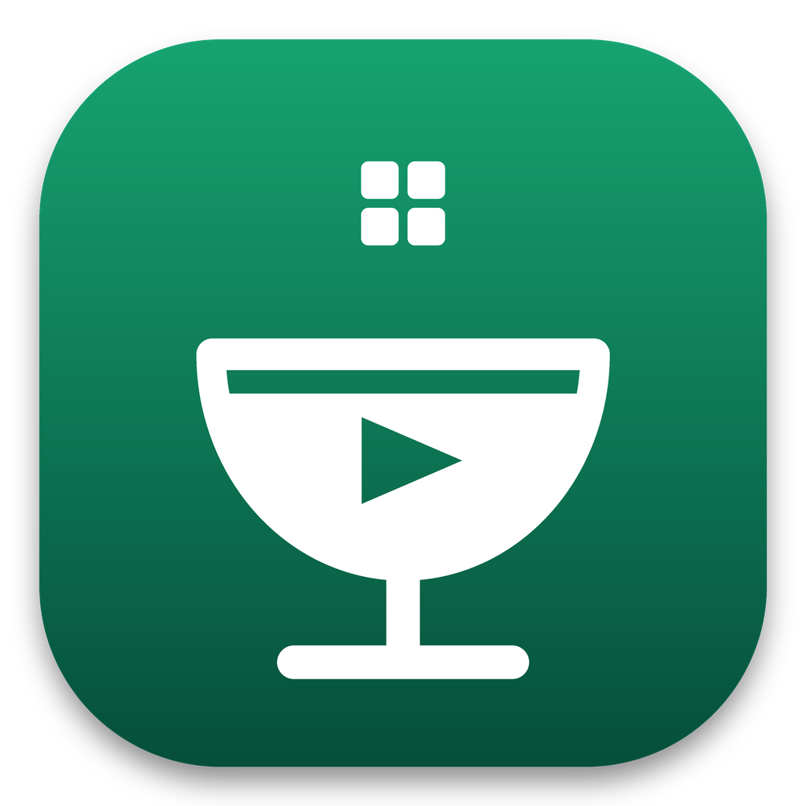

<div dir="rtl">

# حلال واين — halalWine

<p align="center"></p>

**شغّل ألعاب وبرامج ويندوز على جهاز الماك بسحبة واحدة.**
اسحب مجلد اللعبة أو ملف ‎.exe‎ إلى التطبيق، وسيتعرّف حلال واين على محرّك اللعبة ويختار أفضل إعدادات الرسوميات تلقائيًا، ثم يتأكد من أنها تعمل ويتذكّرها للمرة القادمة.

مجاني ومفتوح المصدر، ومبني على Wine وDXMT وDXVK وMoltenVK.

> **الحالة:** نسخة تجريبية مبكرة (0.1). نرحّب بتجاربكم وبلاغاتكم.

## المزايا

- **اسحب وأفلت:** مجلد لعبة، أو ملف ‎.exe‎، أو برنامج تثبيت (‎.exe‎ / ‎.msi‎)، أو ملف ‎.zip‎.
- **اكتشاف تلقائي للمحرّك والرسوميات:** Godot وUnity وUnreal وGameMaker وRPG Maker وRen'Py وFNA/XNA وSource وغيرها، مع قراءة واجهة الرسوميات المستخدمة (DirectX 9/11/12 أو OpenGL أو Vulkan).
- **يجرّب ويتحقق بنفسه:** يشغّل اللعبة، ويراقب ظهور النافذة والأعطال وسجل الأخطاء، وإذا فشل إعداد ما ينتقل تلقائيًا إلى الإعداد التالي.
- **يصلح المشكلات الشائعة:** يثبّت Visual C++ وDirectX وXNA عند الحاجة، ويفعّل دعم AVX للألعاب التي تتطلبه.
- **صريح معك:** يحذّرك قبل التشغيل إذا كانت اللعبة تستخدم نظام مكافحة غش لا يعمل على الماك.
- **واجهة عربية كاملة** من اليمين إلى اليسار، مع الإنجليزية.
- **كل لعبة في بيئة ويندوز مستقلة**، تُنشأ فورًا دون استهلاك مساحة إضافية.

## التثبيت (للمستخدمين)

1. نزّل أحدث ملف ‎`halalWine-x.y.z.dmg`‎ من صفحة [الإصدارات](https://github.com/omarammarthefirst/halalWine/releases).
2. افتح الملف واسحب **حلال واين** إلى مجلد **التطبيقات**.
3. افتح التطبيق. سيرشدك معالج الإعداد إلى:
   - تثبيت **Rosetta** من Apple (إن لم يكن مثبتًا)،
   - تنزيل **محرّك ويندوز** (نحو ٢٥٠ ميغابايت، مرة واحدة فقط).
4. اسحب مجلد لعبتك إلى النافذة واضغط **العب**.

> إن ظهرت رسالة بأن macOS لا يستطيع التحقق من التطبيق: افتح **إعدادات النظام ← الخصوصية والأمن** واضغط **فتح على أي حال**.

**المتطلبات:** جهاز ماك بمعالج Apple (M1 أو أحدث) ونظام macOS 14 (Sonoma) أو أحدث، ويُنصح بـ macOS 15.

## كيف يختار الإعدادات؟

| طبقة الرسوميات | ماذا تفعل | متى تُستخدم | مضمّنة؟ |
|---|---|---|---|
| D3DMetal (من Apple) | DirectX 11/12 ← Metal | ألعاب DirectX 12 والألعاب الحديثة | لا، تستوردها أنت |
| DXMT | DirectX 10/11 ← Metal | الخيار الأول لألعاب DirectX 11 | نعم |
| DXVK + MoltenVK | DirectX 10/11 ← Vulkan ← Metal | خيار احتياطي | نعم |
| WineD3D | DirectX القديم وOpenGL ← OpenGL | الألعاب القديمة وألعاب OpenGL | نعم |

مثال: لعبة **Godot 4** مثل Slay the Spire 2 تُجرَّب بهذا الترتيب:

1. ‏D3DMetal مع ‎`--rendering-driver d3d12`‎
2. ‏WineD3D مع ‎`--rendering-driver opengl3`‎
3. ‏DXMT مع ‎`--rendering-driver opengl3_angle`‎
4. ‏Vulkan عبر MoltenVK

القواعد محفوظة في ملف بيانات ([`rules.json`](Sources/HalalWineCore/Resources/rules.json)) يُحدَّث دون الحاجة إلى إصدار جديد من التطبيق.

## تفعيل D3DMetal (اختياري)

لا تسمح Apple بتضمين D3DMetal داخل التطبيقات، لذلك:

1. نزّل **Game Porting Toolkit** المجانية من [موقع مطوّري Apple](https://developer.apple.com/download/all/?q=game%20porting%20toolkit) (تحتاج حساب Apple مجانيًا).
2. في حلال واين: **الإعدادات ← الرسوميات ← استيراد…** واختر ملف ‎.dmg‎ الذي نزّلته.

## حدود معروفة

- الألعاب التي تستخدم أنظمة مكافحة الغش على مستوى النواة (EasyAntiCheat وBattlEye وVanguard) لا تعمل.
- بعض ألعاب Steam تتطلب تشغيل Steam نفسه، ودعم Steam لويندوز مخطط له لاحقًا.
- يعتمد Wine على Rosetta، وقد أعلنت Apple أن Rosetta الكامل سيبقى حتى macOS 27.

</div>

---

## English

**halalWine runs Windows games and apps on Apple Silicon Macs. Drag a game in and press Play.**

It inspects the game: which file is the real program, which engine built it, which graphics API it uses, and whether anything will block it.

It then works through an ordered list of launch settings. For each one it checks the game actually starts: a window appears, there's no crash, there's no known error in the log, and there's optionally no black screen. If a setting fails it moves on, or fixes a known problem first (Visual C++, DirectX, XNA, AVX). Whatever works is remembered for next time.

Built on Wine, DXMT, DXVK and MoltenVK. Arabic and English, with full right-to-left layout.

### Install

1. Download the latest `halalWine-x.y.z.dmg` from [Releases](https://github.com/omarammarthefirst/halalWine/releases).
2. Drag it to Applications and open it.
3. The setup assistant installs Rosetta and downloads the Windows engine (≈250 MB, once), like WhiskyWine.

Requires an Apple Silicon Mac with macOS 14 or later; macOS 15 is recommended for AVX support.

### Build from source

```bash
swift test                    # core tests (also run on Linux)
scripts/build-app.sh          # → dist/halalWine.app and dist/halalWine-<version>.dmg
.build/release/halalwine plan "/path/to/Game Folder" --all   # see what would be tried
```

### Publish the Windows engine

Run **Actions → Publish Windows engine (runtime) → Run workflow**. This:

1. Downloads Gcenx's macOS Wine build, DXMT and DXVK-macOS.
2. Packages them as `halalwine-runtime-<version>.tar.xz`.
3. Publishes that as a GitHub release.
4. Adds it to [`Runtime/manifest.json`](Runtime/manifest.json), which the app reads.

### Release the app

Tag `vX.Y.Z` and push the tag. The **Release app** workflow builds the `.dmg` and attaches it to a release.

For downloads that open without Gatekeeper warnings, you need an Apple Developer ID (Apple Developer Program, $99/year). Add the signing and notarization secrets listed in [`release.yml`](.github/workflows/release.yml).

### Layout

| Path | What |
|---|---|
| `Sources/HalalWineCore/Inspect` | PE parser, Godot `.pck` reader, engine/API detection, red flags |
| `Sources/HalalWineCore/Plan` | Data-driven launch rules and planner |
| `Sources/HalalWineCore/Runtime` | Runtime manifest/installer, per-backend Wine variants (APFS clones), D3DMetal import |
| `Sources/HalalWineCore/Run` | Prefix templates, launch command builder, session supervisor, log doctor, dependency installer |
| `Sources/HalalWine` | SwiftUI app (setup assistant, library, launch verification, settings) |
| `Sources/halalwine` | Command-line tool |

See [docs/ARCHITECTURE.md](docs/ARCHITECTURE.md) for details.

### License

halalWine's own code is MIT-licensed ([LICENSE](LICENSE)). The Windows engine bundles third-party open-source software under its own licenses ([THIRD_PARTY_NOTICES.md](THIRD_PARTY_NOTICES.md)).

D3DMetal is Apple's. It is never distributed by this project; each user imports it themselves.
